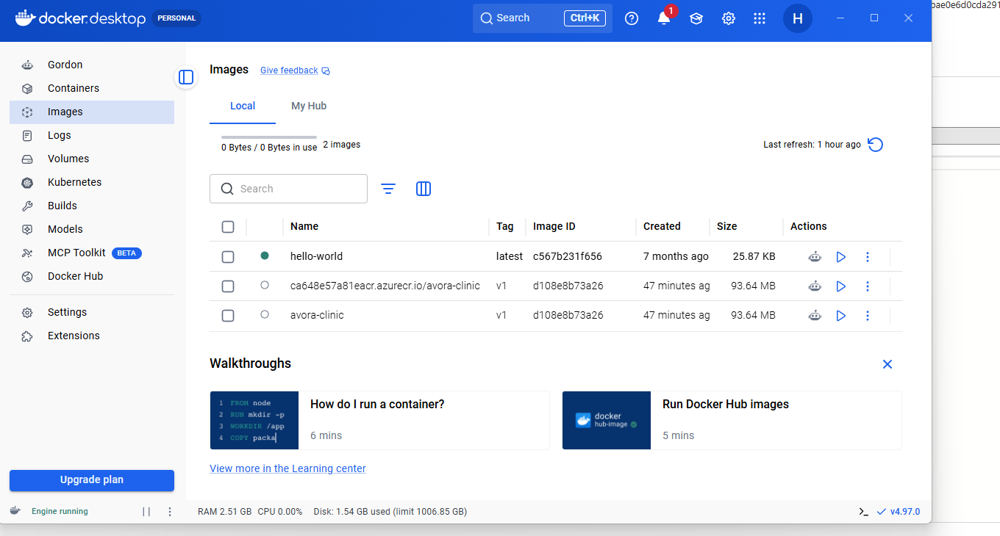

# AVORA CLINIC — Docker & Microsoft Azure Deployment

## Project Overview

This project demonstrates the containerization and cloud deployment of a custom AVORA CLINIC treatment-booking web application.

The application was developed using HTML, CSS and JavaScript, packaged into a Docker container using Nginx, pushed to Azure Container Registry (ACR), and deployed to Azure Container Apps.

This is a separate custom application associated with the wider AVORA CLINIC website project.

## Technologies Used

- HTML5, CSS3 and JavaScript
- Visual Studio Code
- Docker and Docker Desktop
- Nginx Alpine
- Microsoft Azure
- Azure Container Registry (ACR)
- Azure Container Apps
- Azure CLI
- GitHub

## Deployment Architecture

```text
Custom Booking Application
          |
          v
Docker Container (Nginx)
          |
          v
Azure Container Registry
          |
          v
Azure Container Apps
          |
          v
Public HTTPS Endpoint
```

## Docker Configuration

The application uses a lightweight Nginx Alpine image to serve the frontend.

```dockerfile
FROM nginx:alpine
COPY index.html /usr/share/nginx/html/index.html
EXPOSE 80
```

## Deployment Process

1. Created a Dockerfile for the booking application.
2. Built the Docker image locally.
3. Tested the container using Docker Desktop and a local browser.
4. Created an Azure Container Registry.
5. Tagged and pushed the Docker image to the registry.
6. Deployed the image to Azure Container Apps.
7. Enabled external access through a public HTTPS endpoint.
8. Verified that the application loaded successfully in a browser.

## Local Docker Testing

Build the image:

```bash
docker build -t avora-clinic:v1 .
```

Run the container:

```bash
docker run -d -p 8080:80 avora-clinic:v1
```

Open `http://localhost:8080` to view the application locally.

## Deployment Outcome

The custom booking application was successfully deployed to Microsoft Azure and verified through its public HTTPS endpoint.

After completing the deployment demonstration, the Azure resource group was deleted to prevent ongoing cloud charges. The cloud-hosted demonstration is therefore no longer publicly accessible.

## Related Project

**Full AVORA CLINIC website:**  
https://avoraclinic.wixsite.com/my-site-1

**Website GitHub repository:**  
https://github.com/HadiHadi75/avora-clinic-booking-website

The full Wix website, including its AI chatbot, is separate from the Dockerized booking application.

## Skills Demonstrated

- Docker image creation and container testing
- Nginx web application hosting
- Azure Container Registry image management
- Azure Container Apps deployment
- Azure CLI deployment workflow
- Public HTTPS application hosting
- Cloud resource lifecycle management
- Technical documentation

## Deployment Evidence

The screenshots below document the Docker and Microsoft Azure deployment process.

### Docker Container Image



### Azure Container Registry


### Azure Container Apps


### Successfully Deployed Application


